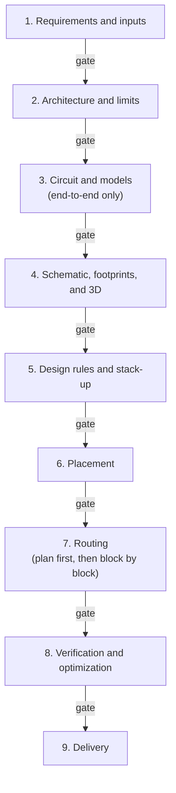

# AI PCB Layout

An AI agent skill for **designing, reviewing, and improving power-electronics PCBs** — converters, inverters, motor drives, gate drivers, power supplies, and battery power paths.

The skill teaches an AI coding agent (Cursor, Claude Code, Codex, or any agent that supports `SKILL.md` skills) to work like a careful power-electronics layout engineer: it traces commutation and gate loops from the switching states, derives clearance and copper limits from standards and design currents, and **stops for your approval after every step**, so you stay in control of every design decision.

> **Note:** The skill helps you reach a well-reasoned design and tells you which evidence is still missing. It does not certify safety or EMC compliance. Measurements and the applicable standards remain the final authority.

## What it covers

- **Switching loops:** commutation cells, gate charge and discharge loops, Kelvin connections, and common-mode paths, derived per switching transition
- **Insulation:** clearance, creepage, and solid insulation derived from the applicable standard and its inputs, never copied from example values
- **Copper capability:** conductor and via sizing from worst-case RMS current and permitted temperature rise
- **Placement and routing:** functional block floorplans, routability checks, and a routing plan you approve before any copper is drawn
- **Verification:** DRC, insulation geometry, parasitic extraction, re-simulation, and thermal checks, each recorded with its evidence type (CAD check, estimate, simulation, or measurement)
- **Delivery:** fabrication and assembly outputs, and a BOM with verified datasheet and order links

It works with any topology, device technology (Si, IGBT, SiC, GaN), and CAD tool. KiCad 9 is covered in the most detail; concept mappings are included for Altium Designer, Allegro/OrCAD, Xpedition/PADS, and Fusion.

## How it works

The agent works in nine steps. After each step it delivers a short report and waits for you to reply **approve**, **approve with changes**, **redo**, or **stop**.



You don't always need all nine steps. In step 1 you agree on a scope:

| Scope | What happens |
|---|---|
| **Review** an existing design | Reads your files and reports prioritized findings. No files are changed. |
| **Small revision** (label, footprint swap, local reroute) | Proposes the change for approval, then edits and rechecks only what it affects. |
| **Create or revise a layout** for an approved circuit | Footprints, rules, placement, routing, verification, and delivery. |
| **End-to-end design** | All nine steps, from requirements to fabrication files. |

For routing you choose who draws the copper: the agent routes everything, you route and the agent verifies, or a hybrid where the agent routes the critical nets and the rest is autorouted.

## Quick start

### 1. Install the skill

Copy the `power-pcb-design` folder into your agent's skills folder:

| Agent | Skills folder |
|---|---|
| Cursor (all projects) | `~/.cursor/skills/` |
| Cursor (one project) | `<your-project>/.cursor/skills/` |
| Claude Code | `~/.claude/skills/` |
| Codex | `~/.codex/skills/` |

On Windows (PowerShell), for Cursor:

```powershell
git clone https://github.com/ChengminLi/AI-PCB-layout.git
Copy-Item -Recurse AI-PCB-layout\power-pcb-design "$env:USERPROFILE\.cursor\skills\"
```

On macOS or Linux, for Cursor:

```bash
git clone https://github.com/ChengminLi/AI-PCB-layout.git
mkdir -p ~/.cursor/skills && cp -r AI-PCB-layout/power-pcb-design ~/.cursor/skills/
```

No Git? Click **Code → Download ZIP** on this page and copy the `power-pcb-design` folder manually. Restart your agent or open a new chat so it picks up the skill.

### 2. Ask your agent

Open your PCB project folder in the agent and describe what you want. For example:

- *"Review the layout of my 48 V to 12 V synchronous buck in KiCad 9. Don't change any files."*
- *"Improve the gate loop of Q1 and Q2 on my SiC half-bridge board."*
- *"Design a 2-layer 24 V to 5 V, 3 A synchronous buck end to end in KiCad 9."*

The agent will start with step 1: it inspects your files, asks only for the information that changes decisions, and proposes a scope and step plan for your approval.

## Repository layout

```
AI-PCB-layout/
├── power-pcb-design/        The skill
│   ├── SKILL.md             Workflow, review gates, and working rules
│   └── references/          Detailed guidance, read by the agent step by step
├── examples/                Real design examples made with the skill
└── CONTRIBUTING.md          How to add examples or improve the skill
```

The reference files cover [topologies](power-pcb-design/references/topologies.md), [devices](power-pcb-design/references/devices.md), [regimes and standards](power-pcb-design/references/regimes-and-standards.md), [CAD and tools](power-pcb-design/references/cad-and-tools.md), [electrical layout](power-pcb-design/references/electrical-layout.md), [insulation and copper](power-pcb-design/references/insulation-and-copper.md), [analysis and measurement](power-pcb-design/references/analysis-and-measurement.md), [implementation and delivery](power-pcb-design/references/implementation-and-delivery.md), and [behavioral evaluation](power-pcb-design/references/behavioral-evaluation.md).

## Examples

See [examples/](examples/) for boards designed or reviewed with this skill, including the design files, review-gate reports, and lessons learned.

## Contributing

Design examples, bug reports, and improvements to the skill are welcome. See [CONTRIBUTING.md](CONTRIBUTING.md).
