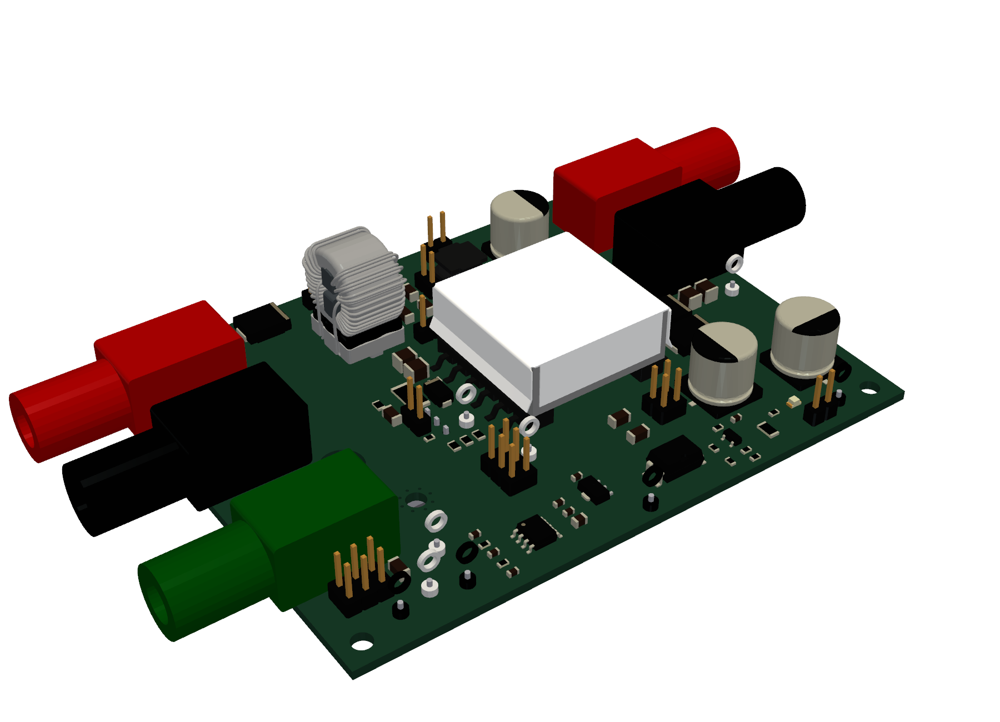
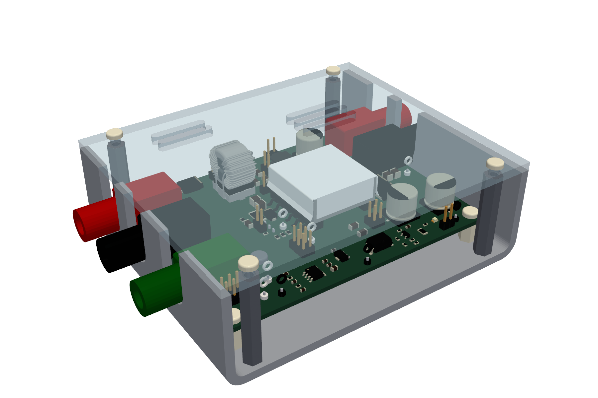
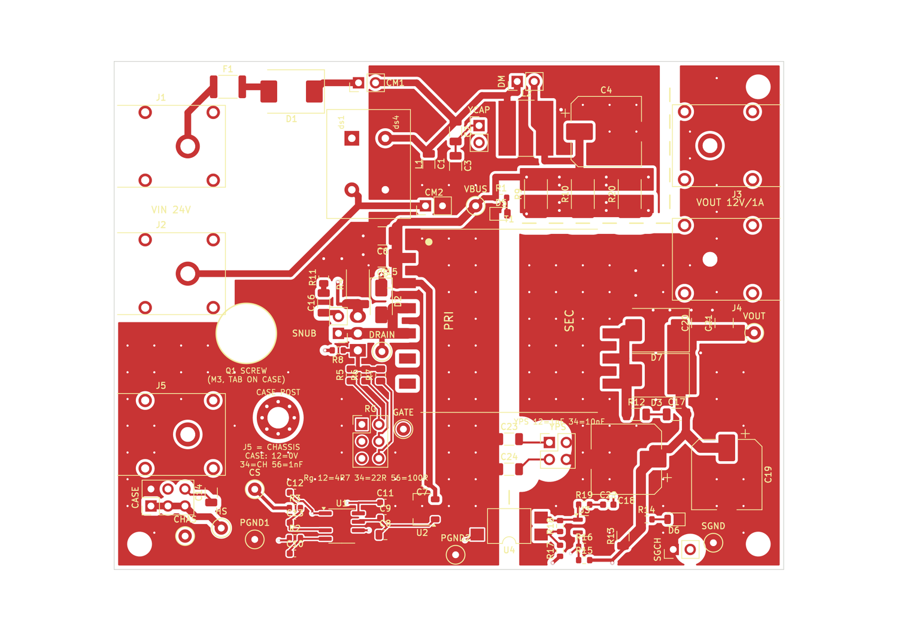
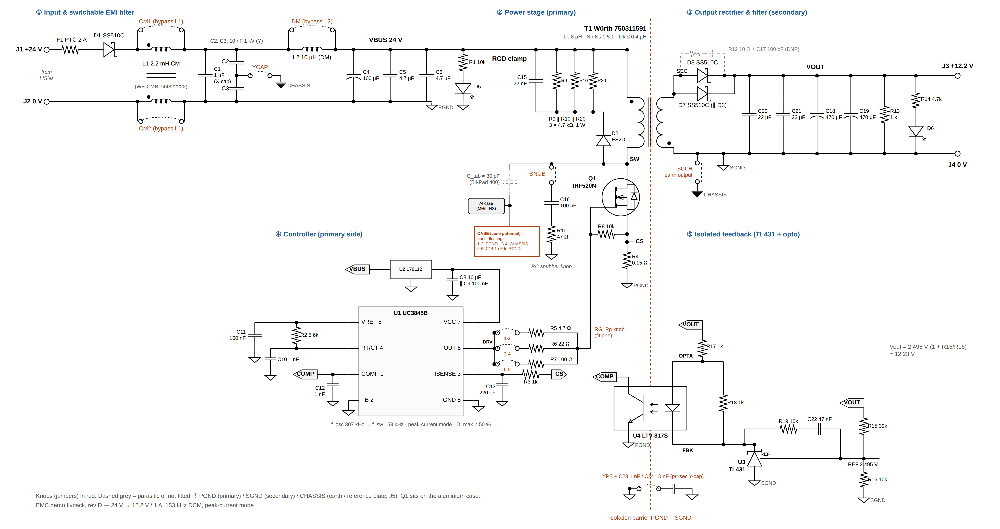
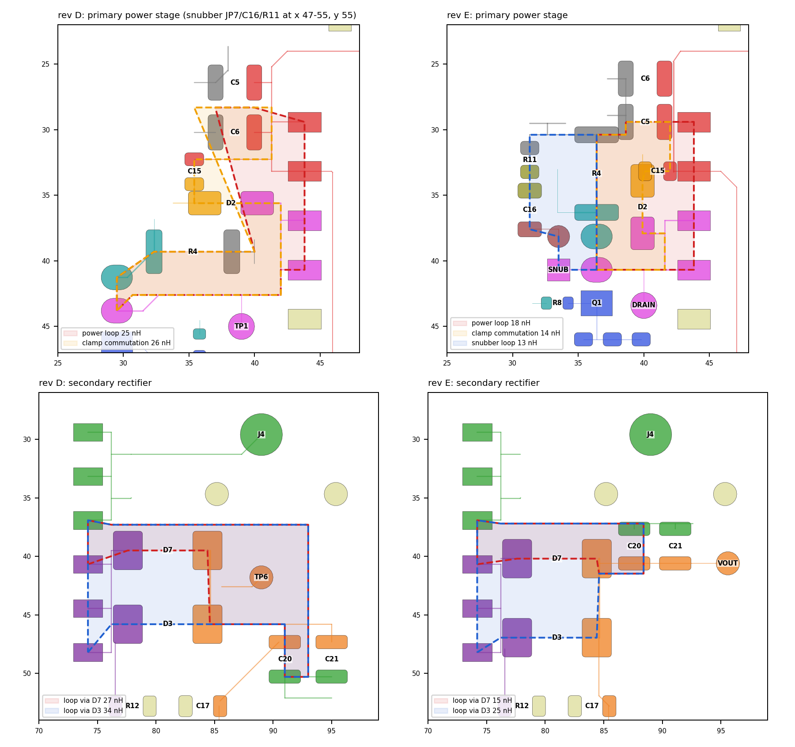
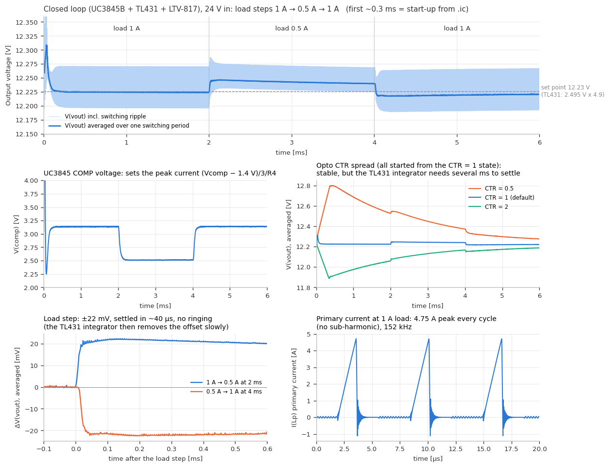

# EMC demonstration flyback converter (24 V to 12 V)

A small isolated flyback converter built as a live demonstrator for the EMC lectures at TU/e. Jumpers on the board, the **"EMC knobs"**, switch the filter stages, the switching speed, a snubber, the potential of the heatsink case, the Y-capacitors, and the output earthing, so students can watch the conducted emissions change on two LISNs.

> **Status:** design complete and checked by calculation, simulation, and CAD rule checks. **Not yet prototyped**: the results below are predictions, not measurements.

## Design at a glance

| Item | Value |
|---|---|
| Topology | Isolated flyback, discontinuous conduction mode, peak-current mode control (UC3845B, TL431 and LTV-817S feedback) |
| Input / output | 24 V (20–30 V) in, 12.2 V / 1 A out |
| Switching frequency | 153.6 kHz, just above the 150 kHz start of CISPR band B |
| Devices | IRF520N MOSFET (100 V, TO-220) mounted on the case floor; Würth 750311591 transformer; 2 × SS510C rectifiers in parallel |
| Board | 2 layers, 100 × 76 mm, 1.6 mm FR-4, 1 oz copper |
| Mechanics | Bent 3 mm aluminium U-channel case (112 × 94 × 33 mm) that is also the MOSFET heatsink, with a clear acrylic cover |
| CAD tool | KiCad (version 7 file format; opens in KiCad 7, 8, and 9) |
| Scope | End-to-end design, from requirements to fabrication files |
| Revision | E (3 October 2026) |

## The EMC knobs

| Jumper | Setting | Demonstrates |
|---|---|---|
| RG | 4.7 Ω / 22 Ω / 100 Ω gate resistor | Switching speed (5.0 / 2.5 / 0.65 V/ns) versus spectrum |
| CASE | Floating / PGND / chassis / 1 nF | The case is the heatsink: where its common-mode current flows |
| CM1 + CM2 | Common-mode choke bypassed | Effect of the common-mode filter |
| YCAP | Input Y-capacitors to chassis | Y-capacitor return path |
| DM | Differential-mode inductor bypassed | Effect of the differential-mode filter |
| SNUB | 100 pF + 47 Ω drain snubber | Damping of the turn-off ringing |
| YPS | 1 nF / 10 nF primary-to-secondary | External Y-capacitor across the isolation barrier |
| SGCH | Secondary ground to chassis | Earthed output: primary-secondary current through the chassis |

## Images

| | |
|---|---|
|  |  |
| The board in its case. The MOSFET sits under the board with its tab on the case floor. | Top copper. The 3 mm copper-free band in the middle separates primary and secondary. |
|  |  |
| Circuit topology with the jumper knobs in red. | Power-cell loops before (rev D) and after (rev E) the high-frequency re-layout. |

More: [bottom copper](images/pcb-bottom.png), [predicted board temperature](images/thermal-map.png).

## Results and evidence

| Criterion | Result | Evidence type |
|---|---|---|
| Output voltage and ripple | 12.22 V at 1 A, 75 mV peak-to-peak (requirement ≤ 100 mV) | Simulation (ngspice) |
| Loop stability | Phase margin 63–80° over optocoupler CTR 0.5 to 2 | Small-signal model |
| Efficiency | 83.5 % power stage; about 78–79 % for the whole board | Simulation plus loss estimate |
| MOSFET drain peak | 66 V at 24 V in, about 73 V at 30 V in (100 V rating) | Simulation and calculation |
| Loop inductance, rev D → E | Clamp loop 26 → 14 nH, snubber loop 32 → 13 nH, primary power loop 25 → 18 nH | Centre-line estimate (upper bound, for comparison) |
| Clearance and creepage | 0 of 1459 net pairs below IPC-2221B or the design rules; 2.5 mm primary-secondary | Script on the KiCad geometry, plus KiCad DRC |
| DRC and connectivity | 0 clearance errors, 0 unconnected items; schematic and PCB netlists match | CAD check |
| Temperatures at 25 °C | Clamp resistors 70 °C, MOSFET junction 41 °C (58 °C at Rg = 100 Ω) | Board thermal model |
| Conducted emissions | Not yet measured | — |

## Design findings

- **The snubber beats the gate resistor at high frequency.** In simulation, the 100 Ω gate resistor mainly lowers the 5–15 MHz band, while the RC snubber removes the 20–30 MHz ringing peak by about 20 dB. To be confirmed with LISN measurements.
- **The case is the strongest knob.** The MOSFET tab couples about 30 pF into the case. With the case on chassis and no filter, this path alone is estimated at 20–40 dB above the CISPR 32 class B limit; connecting the case to PGND returns the current locally.
- **The RCD clamp is the largest single loss** (0.91 W), more than the MOSFET at the default gate resistor.
- **Rev E shrank the high-frequency loops** by moving the clamp and snubber into the power cell, so they act within about 14 nH of the drain instead of 26–32 nH.
- **Voltage-based design rules in KiCad.** Clearances are set per net class from each net's worst-case voltage (0.6 / 0.4 / 0.2 mm, 2.5 mm across the barrier) in the project's `.kicad_dru` file, so KiCad's DRC and zone filler enforce them.

## Simulation

Two LTspice schematics in [`simulation/`](simulation/), built from the board's component values:

| File | What it simulates |
|---|---|
| `EMC_flyback_power_stage.asc` | Open-loop power stage at a fixed duty cycle: stresses, waveforms, and switching speed versus gate resistor |
| `EMC_flyback_closed_loop.asc` | Power stage plus the real control loop, with behavioural UC3845B, TL431, and LTV-817S models: regulation, load steps, cold start, efficiency |

Keep the files in one folder (clone the repository or use **Code → Download ZIP**): the closed-loop schematic needs `EMC_flyback_control.lib` and the three `.asy` symbols next to it. Each schematic has `.param` knobs (`Rg`, `SNUB`, `CTR`, `Vin`, and others) that match the jumpers on the board. The [simulation README](simulation/README.md) explains how to run them, the suggested experiments, and the reference results.

The schematics were verified in ngspice because LTspice was not available when they were made; if LTspice reports a convergence problem, see the tips at the end of the simulation README. The device models are approximate (behavioural controller models, generic diodes, a fitted MOSFET model), and common-mode paths are not modelled, so use the results for trends and margins.

## Report

The [design report](report/EMC_flyback_design_report.pdf) (39 pages) covers the calculations, simulations, thermal model, layout, mechanics, and the conducted-emission test procedure.

## Files

| Path | Content |
|---|---|
| [`report/`](report/) | Design report (PDF) |
| [`design/`](design/) | KiCad project: open `emc_flyback.kicad_pro`. Includes the custom symbol and footprint libraries, 3D models, and a [schematic PDF](design/emc_flyback_schematic.pdf) |
| [`simulation/`](simulation/) | LTspice schematics (open loop and closed loop), behavioural model library and symbols, plots, and a how-to README |
| [`outputs/`](outputs/) | Gerbers for JLCPCB, JLC BOM and placement files, full BOM with datasheet links, and hand-fitted parts list |
| [`outputs/case/`](outputs/case/) | Workshop drawing of the case and cover (PDF) and their STEP models |
| [`images/`](images/) | 3D renders, copper views, topology, loop and thermal figures |

### Notes

- **Three 3D models are not included** because of manufacturer licensing: the transformer T1 (Würth 750311591), the common-mode choke L1 (Würth 744822222), and the inductor L2 (Bourns SRN8040TA, used for its footprint-compatible body). See [design/EMC_Demo.3dshapes/README.md](design/EMC_Demo.3dshapes/README.md) to add them; without them those parts are simply missing from the 3D view.
- **Case revision.** The case STEP files keep their rev D names. Rev E moved the MOSFET, so check the position of its mounting hole (hole C, 22.74 / 49.68 mm) against the drawing before making a case.
- **Before ordering:** the LCSC number of R9/R10/R20 (UNI-ROYAL 25121WJ0472T4E) is blank in `JLC_BOM.csv`, and L2 (LCSC C37429) may be out of stock; see section 9 of the report.
